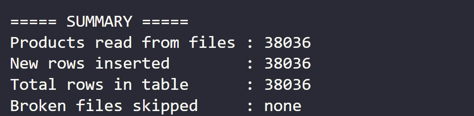

# Tiki Postgres Loader

Loads Tiki product data (JSON files from [tiki-product-scraper](https://github.com/<your-username>/tiki-product-scraper)) into a PostgreSQL database using Python.

## Tech stack

- Python 3.12, managed with [uv](https://docs.astral.sh/uv/)
- PostgreSQL 17 (Docker)
- psycopg 3, python-dotenv

## Project structure

```
├── src/load_to_postgres.py   # loader script
├── sql/create_tables.sql     # table schema
├── docs/                     # screenshots
├── .env.example              # config template
└── pyproject.toml / uv.lock  # dependencies
```

## How to run

1. Start Postgres:
   ```bash
   docker run --name tiki-postgres -e POSTGRES_USER=tiki -e POSTGRES_PASSWORD=tiki123 -e POSTGRES_DB=tiki -p 5433:5432 -v tiki_pgdata:/var/lib/postgresql/data -d postgres:17
   ```
2. Create the table:
   ```bash
   docker exec -i tiki-postgres psql -U tiki -d tiki < sql/create_tables.sql
   ```
3. Configure: `cp .env.example .env` and set your values (`DATA_DIR` = folder with `products_*.json`).
4. Install dependencies and run:
   ```bash
   uv sync
   uv run src/load_to_postgres.py
   ```

## Design decisions

- `id` is the PRIMARY KEY and inserts use `ON CONFLICT (id) DO NOTHING`, so the loader is **idempotent**: re-running it never creates duplicates.
- Inserts are batched per file (`executemany` + one commit per file) instead of row by row.
- Broken/incomplete JSON files are skipped and reported instead of stopping the whole run.
- `images` is stored as `JSONB` to keep the list structure.
- Credentials live in `.env` (git-ignored), never in code.

## Results

- Files loaded: 51 (scraping in Project 02 is partial; re-running the loader after completing it adds only new products)
- Rows in `products`: <N>
- Second run: 0 new rows inserted (idempotency confirmed)



## Issues encountered

| Problem                             | Cause                                          | Fix                                               |
| ----------------------------------- | ---------------------------------------------- | ------------------------------------------------- |
| `docker` not found in WSL           | Docker Desktop WSL integration off             | Enabled in Settings → Resources → WSL integration |
| `permission denied ... docker.sock` | user not in `docker` group                     | `sudo usermod -aG docker $USER`                   |
| `password authentication failed`    | a local Postgres in WSL already used port 5432 | mapped Docker to port 5433                        |
| `.env` had CRLF line endings        | file created on Windows                        | converted to LF                                   |
